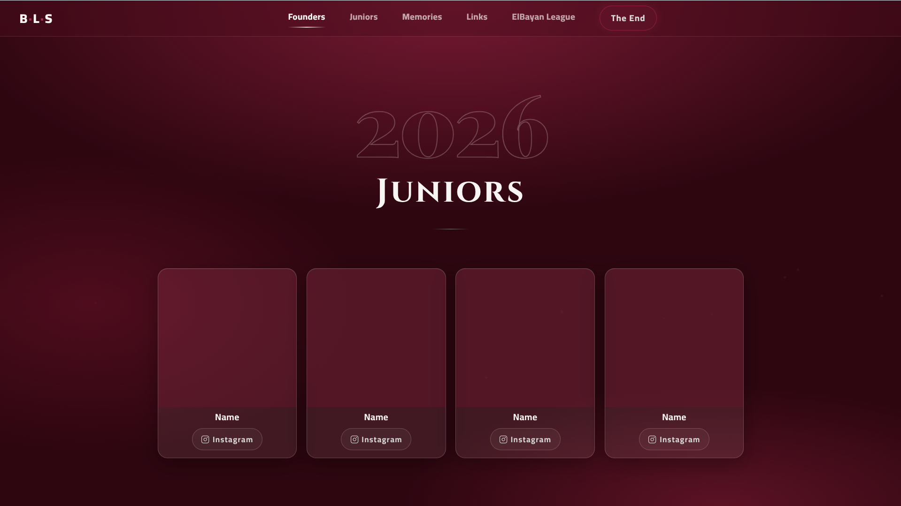

 

  <h1 align="center">🎓 BLS Juniors 2026</h1>
  

    <strong>One School. Countless Memories. One Unforgettable Journey.</strong>
     
    A digital home for the memories, achievements, and unforgettable moments of the BLS Class of 2026.
  

 
 ---

## 📖 About The Project

**BLS Juniors 2026** is a dedicated digital experience celebrating the journey of the BLS Class of 2026.

Designed to bring together the moments that define school life, the website showcases memorable experiences, sports tournaments, student activities, and special highlights in one place.

At its heart is a collection of memories that reflects the friendships, achievements, and shared experiences that make these school years truly unforgettable.

More than just a website, **BLS Juniors 2026** serves as a digital keepsake — preserving the spirit of a graduating class and celebrating the moments that will be remembered long after the journey ends.

## ✨ Features

- 🎓 **Class of 2026** — A dedicated digital experience celebrating the BLS graduating class.
- 🎬 **Memories Video** — A central video experience highlighting memorable moments from school life.
- 🏆 **Sports & Tournaments** — A showcase of school competitions, sporting events, and achievements.
- 📸 **School Memories** — A collection of meaningful experiences and unforgettable highlights.
- 🎨 **Custom Visual Identity** — A distinctive design inspired by the identity and spirit of BLS Juniors.
- 📱 **Responsive Experience** — An adaptable layout designed for desktop, tablet, and mobile devices.
- ⚡ **Interactive Interface** — A user-friendly browsing experience with interactive elements.
- 🌐 **Accessible Online** — A centralized platform for exploring and revisiting class memories.

## 🎯 Project Purpose

The goal of **BLS Juniors 2026** is to create a central place where the school's most memorable experiences can be celebrated and preserved.

By bringing together videos, activities, competitions, and special moments, the website transforms a collection of school memories into a lasting digital experience for the entire class.

## 🛠️ Tech Stack

  

- **HTML5** — Website structure and content.
- **CSS3** — Styling, animations, and responsive layouts.
- **JavaScript** — Interactive elements and website functionality.
- **Responsive Design** — Optimized for desktop, tablet, and mobile devices.
- **Vercel** — Website deployment and hosting.
- **Git & GitHub** — Version control and project management.

## 🖥️ Website Preview

  

## 🌐 Live Website

## </> Developer

Developed by **[Raed Mosaed](https://github.com/raedmosaed0)**

---

  <strong>BLS Juniors 2026 — Memories That Last Forever. ❤️</strong>

